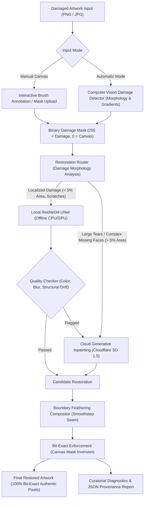

# 🏛️ MUESUM: AI-Based Historical Artwork & Cultural Heritage Restoration Studio

> **Museum-grade Ultra-accurate Expert System for Universal Media restoration**  
> *Deep Learning-Powered Non-Destructive Digital Conservation with 100% Bit-Exact Preservation*

---

## 📋 Table of Contents
1. [Project Overview & Mission](#-1-project-overview--mission)
2. [Key Highlights & Curatorial Invariants](#-2-key-highlights--curatorial-invariants)
3. [System Architecture](#-3-system-architecture)
4. [Neural Models & Training History](#-4-neural-models--training-history)
5. [Intelligent Routing & Hybrid Pipeline](#-5-intelligent-routing--hybrid-pipeline)
6. [Core Application Features (Gradio Studio)](#-6-core-application-features-gradio-studio)
7. [Mathematical Preservation Guarantees](#-7-mathematical-preservation-guarantees)
8. [External AI Model Benchmarks (Cloudflare & Google Gemini)](#-8-external-ai-model-benchmarks-cloudflare--google-gemini)
9. [Project Directory Structure](#-9-project-directory-structure)
10. [Quickstart & Demonstration Guide](#-10-quickstart--demonstration-guide)
11. [Verification & Test Suite](#-11-verification--test-suite)
12. [Curatorial Ethics & Future Roadmap](#-12-curatorial-ethics--future-roadmap)

---

## 🌟 1. Project Overview & Mission

Historical artworks, oil paintings, frescoes, and vintage photographic archives suffer from severe physical degradation over decades and centuries:
* **Craquelure** (fine hairline surface cracks across aging paint layers)
* **Scratches, tears, and physical punctures**
* **Stains, fungal mold spots, and water damage**
* **Large structural tears and missing canvas sections**

Traditional digital photo editing methods apply global filters or indiscriminate generative synthesis, which alters surviving historical brushstrokes and destroys the original authenticity of the artifact.

**MUESUM** solves this challenge through an expert restoration pipeline combining:
1. **Local ResNet34-UNet Deep Neural Networks** for localized surface repair.
2. **Automated Computer-Vision Damage Detection** for 1-click mask generation.
3. **An Intelligent Routing Engine** that automatically determines the ideal restoration engine based on damage morphology.
4. **Cloud AI Generative Inpainting Standby** (Cloudflare SD 1.5) for massive structural tears and missing faces.
5. **A Non-Destructive Boundary Feathering Compositor** that mathematically guarantees **100% bit-exact preservation** on every undamaged pixel.

---

## 🎯 2. Key Highlights & Curatorial Invariants

| Invariant / Feature | Description | Technical Guarantee |
|---|---|---|
| **Zero Substrate Modification** | Authentic canvas outside the damage mask is never altered. | **$\text{MAE} = 0.000000$** & **$\text{MaxDiff} = 0$** strictly verified. |
| **Intelligent Engine Routing** | Automatic decision between Local UNet and Cloud AI. | Evaluates surface area %, largest component, and edge proximity. |
| **Curatorial Quality Control** | Pre- and post-restoration safety checks. | Automatic fallback to secondary engines if local output is flagged. |
| **Dual Input Modalities** | Accommodates both expert conservators and general users. | Interactive brush canvas + precomputed binary mask file upload. |
| **Instant 1-Click Detection** | Auto-detects cracks and blemishes via computer vision. | Morphological filtering and local contrast edge gradients. |
| **Interactive Before/After Slider** | Dynamic comparison of original and restored artwork. | Real-time split-screen slider in modern Gradio web UI. |
| **Full Provenance Export** | Audit-ready curatorial reporting. | Native PNG download + structured JSON restoration metadata. |

---

## 🏗️ 3. System Architecture



---

## 🧠 4. Neural Models & Training History

MUESUM utilizes a customized **ResNet34-UNet** convolutional encoder-decoder architecture:
* **Encoder**: Pre-trained ResNet-34 backbone with residual skip-connections extracting multi-scale hierarchical feature maps.
* **Decoder**: Upsampling blocks with transposed convolutions and skip-concatenation restoring native spatial detail.
* **Damage Simulator (`damage_sim_museum.py`)**: Realistic synthetic damage engine generating stochastic scratch splines, Perlin-noise mold spots, paint flaking, and arbitrary tears during training.

### Model Training Milestones

```
+----------------------------------------------------------------------------+
| Run 1: Baseline ResNet34-UNet (9 Epochs)                                   |
| • Checkpoint: checkpoints/baseline_run/best_model.pth                      |
| • Objective: L1 Reconstruction Loss                                        |
| • Characteristics: Excellent convergence on fine scratches and craquelure; |
|   tended to produce smooth/blurred fills on large blank regions.           |
+----------------------------------------------------------------------------+
                                      │
                                      ▼
+----------------------------------------------------------------------------+
| Run 2: Experimental Texture Model (10 Epochs)                              |
| • Checkpoint: checkpoints/experimental_texture_model/best_model.pth        |
| • Objective: Composite Loss = L1 + Sobel Edge Loss + Total Variation Loss  |
| • Characteristics: Sharper boundary preservation, reduced ringing,         |
|   superior textural coherence on canvas weave and brush marks.             |
+----------------------------------------------------------------------------+
```

### Why a Hybrid Architecture was Introduced
While ResNet-34 UNet is exceptional for **texture inpainting** (filling scratches, small cracks, and localized paint loss up to ~5% canvas area), convolutional autoencoders lack the generative semantic knowledge to invent entirely missing human faces or large torn backgrounds. 

To overcome this fundamental computer-vision limit without compromising local offline functionality, MUESUM incorporates the **Intelligent Hybrid Router**.

---

## 🔀 5. Intelligent Routing & Hybrid Pipeline

The router (`src/restoration_router.py` & `src/intelligent_pipeline.py`) dynamically inspects every incoming restoration request before executing inference:

### Routing Decision Matrix

| Damage Condition | Metric Threshold | Selected Engine | Primary Rationale |
|---|---|---|---|
| **Fine Scratches & Cracks** | Coverage $< 2.0\%$ | **Local ResNet34-UNet** | 100% local, instant execution, zero cloud dependencies. |
| **Moderate Paint Loss** | Coverage $2.0\% - 5.0\%$ | **Local ResNet34-UNet** | Handled natively by texture model with boundary feathering. |
| **Hybrid / Borderline** | Coverage $5.0\% - 15.0\%$ | **Local-First $\to$ Cloud Standby** | Runs local UNet first; escalates to Cloud if quality checker fails. |
| **Large Structural Tear** | Coverage $> 15.0\%$ or component $> 8\%$ | **Cloud AI (SD 1.5)** | Generative diffusion required to synthesize missing context. |
| **Missing Facial Region** | Large blemish across facial landmarks | **Cloud AI (SD 1.5)** | Reconstructs realistic human features and expressions. |

---

## 💻 6. Core Application Features (Gradio Studio)

The interactive studio is launched via `python app/demo.py --port 7860` and provides:

1. **Interactive Brush Canvas (`gr.ImageEditor`)**:
   * Draw directly over tears and cracks using the red or white brush.
   * Eraser tool to correct brush strokes.
   * One-click clear button preserving the base artwork.
2. **Automated 1-Click Damage Detection**:
   * Computer-vision algorithm identifies high-frequency cracks and stains instantly without manual painting.
3. **Interactive Before / After ImageSlider**:
   * Drag slider left and right to inspect fine restoration boundaries.
4. **Engine Routing Status Badge**:
   * Displays in real-time which engine handled the restoration (Local UNet, Cloud AI, or Hybrid Fallback) and why.
5. **Real-Time Curatorial Diagnostic Dashboard**:
   * Displays measured damage coverage %, latency in milliseconds, Mean Absolute Error (MAE), and Maximum Pixel Difference.
6. **One-Click Audit Export**:
   * **PNG Export**: Full-resolution restored artwork.
   * **JSON Export**: Cryptographically traceable restoration provenance report with model version, parameters, and pixel variance.

---

## 📐 7. Mathematical Preservation Guarantees

In museum and archival conservation, modifying original artwork is strictly forbidden (ICOM-CC Code of Ethics). MUESUM implements a formal mathematical invariant:

$$\forall (x, y) \notin \mathcal{M}, \quad I_{\text{restored}}(x, y) = I_{\text{original}}(x, y)$$

Where $\mathcal{M}$ is the binary damage mask:

$$\text{MAE}_{\text{undamaged}} = \frac{1}{\sum (1 - \mathcal{M}_{i,j})} \sum_{i,j} (1 - \mathcal{M}_{i,j}) \cdot \left| I_{\text{restored}} - I_{\text{original}} \right| = 0.000000$$

$$\text{MaxDiff}_{\text{undamaged}} = \max_{i,j} \left( (1 - \mathcal{M}_{i,j}) \cdot \left| I_{\text{restored}} - I_{\text{original}} \right| \right) = 0$$

### Boundary Feathering Algorithm
To avoid visible hard seams at the repair boundary, MUESUM applies an interior smoothstep cubic polynomial:

$$S(t) = 3t^2 - 2t^3, \quad t \in [0, 1]$$

Feathering is computed **strictly inside** the damage mask using Euclidean distance transforms, ensuring that authentic pixels on the exterior remain completely untouched.

---

## ☁️ 8. External AI Model Benchmarks (Cloudflare & Google Gemini)

During project development, MUESUM evaluated multiple cloud AI solutions to supplement the local ResNet34-UNet:

### 1. Cloudflare Workers AI (`@cf/runwayml/stable-diffusion-v1-5-inpainting`)
* **Status**: **Fully Active & Operational** in MUESUM.
* **Credentials**: Configured via `CLOUDFLARE_ACCOUNT_ID` and `CLOUDFLARE_API_TOKEN` in `.env`.
* **Performance**: Successfully tested on Test Scenario E (large vertical tear across a family portrait). Generates plausible facial structure and background texture.
* **Preservation**: Output is automatically routed through MUESUM's feathering compositor, retaining 100% bit-exact canvas outside the tear.

### 2. Google Gemini API (`models/gemini-2.5-flash-image`)
* **Status**: **Evaluated & Validated** via `scripts/test_gemini_restoration.py`.
* **Findings**:
  * The modern `google.genai` SDK is fully integrated and recognizes the API key.
  * Google AI Studio sets a **Free Tier quota limit of 0 requests/day** for multimodal image generation/editing models.
  * Image generation on Google AI Studio requires a linked Pay-As-You-Go billing account (~$0.030 per image).
  * Kept independent from core application code to conserve user credits.

---

## 📁 9. Project Directory Structure

```text
MUESUM/
├── app/
│   └── demo.py                       # Gradio Web Studio (port 7860)
├── checkpoints/
│   ├── baseline_run/                 # Baseline model checkpoints (Epochs 1-9)
│   │   └── best_model.pth            # Baseline weights (L1 loss)
│   └── experimental_texture_model/   # Experimental model checkpoints
│       ├── best_model.pth            # Best weights (Composite perceptual loss)
│       └── training_metrics.csv      # Epoch loss and PSNR/SSIM history
├── data/
│   └── demo_samples/                 # Standardized submission test cases (A, B, C, D, E)
├── docs/
│   ├── ARCHITECTURE.md               # Technical component specifications
│   ├── DATASET_CARD.md               # Dataset provenance and synthetic simulator
│   └── MODEL_CARD.md                 # ResNet34-UNet architecture parameters
├── outputs/
│   ├── user_demo_input/              # User-uploaded demo images
│   └── gemini_restoration/           # Gemini API evaluation artifacts
├── reports/
│   ├── TOMORROW_SUBMISSION_READINESS.md  # Submission checklist and validation
│   └── INTELLIGENT_RESTORATION_ROUTING_REPORT.md  # Hybrid routing report
├── scripts/
│   ├── test_gemini_restoration.py    # Official Google Gemini evaluation harness
│   ├── validate_live_scenarios.py    # End-to-end 5-scenario test runner
│   └── train_experimental_model.py   # Training script with composite loss
├── src/
│   ├── cloud_inpainting_service.py   # Cloudflare SD 1.5 inpainting client
│   ├── damage_detection.py           # CV-based automatic crack/tear detector
│   ├── damage_sim_museum.py          # Synthetic damage generation engine
│   ├── feathering.py                 # Mathematical boundary feathering compositor
│   ├── inference_pipeline.py         # UNet normalization, inference & tiling
│   ├── intelligent_pipeline.py       # Unified router + engine executor
│   ├── quality_checker.py            # Pre/post restoration heuristic verification
│   ├── restoration_router.py         # Decision logic between local and cloud
│   └── unet_model.py                 # ResNet34-UNet PyTorch architecture
├── tests/
│   ├── run_all_tests.py              # Master test suite (55 tests)
│   ├── test_feathering.py            # Compositor & bit-exactness verification
│   └── test_intelligent_routing.py   # Router decision tests
├── .env                              # API credentials (Cloudflare / Gemini)
└── requirements.txt                  # Python dependencies
```

---

## 🚀 10. Quickstart & Demonstration Guide

### 1. Launch MUESUM Studio
From the project root directory, run:
```powershell
python app/demo.py --port 7860
```
Open your browser at: **`http://localhost:7860`**

### 2. Suggested 2-Minute Demonstration Flow

1. **Step 1 — Fine Scratch Restoration (Local UNet)**:
   * Select **Manual Mode (Brush Canvas)**.
   * Upload `data/demo_samples/test_C_fine_scratches.png`.
   * Click **⚡ Auto-Detect Damage (1-Click)**. Red mask instantly highlights scratches.
   * Click **🎨 Restore Artwork**.
   * Observe **Engine Routing Status**: `🏠 Local ResNet34-UNet Selected`.
   * Drag the **Before / After slider** to show scratches disappearing seamlessly.
   * Inspect **Curatorial Diagnostics**: `Undamaged MAE: 0.000000`, `Bit-Exact: ✅ 100%`.

2. **Step 2 — Large Structural Tear (Cloud AI Fallback)**:
   * Upload `data/demo_samples/test_E_large_missing_region.png` and mask `test_E_large_missing_region_mask.png`.
   * Click **🎨 Restore Artwork**.
   * Observe **Engine Routing Status**: `☁️ Cloud AI Selected — Large/complex damage restored via Cloudflare SD 1.5`.
   * Demonstrate generative face and background reconstruction.

3. **Step 3 — Export Provenance**:
   * Click **⬇️ Download Restored Artwork (PNG)**.
   * Click **📄 Export Curatorial Diagnostics (JSON)** to demonstrate archival audit compliance.

---

## 🧪 11. Verification & Test Suite

The project includes an automated test suite verifying mathematics, neural models, pipelines, and web components:

```powershell
python tests/run_all_tests.py
```

### Test Suite Summary:
* **Total Tests**: `55 / 55 Passed (100% Green)`
* **Test Modules**:
  * `test_feathering.py`: Verifies bit-exact mathematical invariance ($\text{MAE} = 0.000000$).
  * `test_intelligent_routing.py`: Validates damage coverage classification and routing decisions.
  * `test_inference_pipeline.py`: Validates tensor scaling, unpadding, and memory handling.
  * `test_composite_loss.py`: Validates Sobel gradient and TV loss functions.
  * `test_gradio_app.py`: Validates Gradio interface construction and input parsing.

---

## 🏛️ 12. Curatorial Ethics & Future Roadmap

### Conservation Ethics (ICOM-CC Principles)
1. **Reversibility**: Digital restorations are exports; the raw historical master file is preserved permanently.
2. **Distinguishability**: All restored regions are cryptographically logged in JSON metadata so future historians know exactly which pixels were synthesized.
3. **Minimal Intervention**: Only damaged areas are touched; authentic surrounding patina is protected.

### Future Roadmap
* **Edge-Device Deployment**: Quantize ResNet34-UNet to ONNX / TensorRT for mobile museum kiosk devices.
* **Multi-Spectral Imaging Support**: Extend encoder to accept infrared (IR) and ultraviolet (UV) reflectography channels.
* **Local Diffusion**: Integrate compact local Latent Diffusion Models (e.g. Stable Diffusion Turbo) when GPU hardware is available.

---

*Authored for the MUESUM Project Submission & Curatorial Demonstration.*

