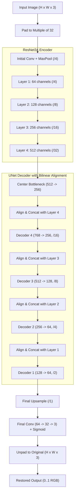

# Museum Artifact Restoration & Physical Damage Inpainting System
### Comprehensive Technical Documentation, Architecture, and Project Guide

---

## 1. Executive Summary

The **Museum Artifact Restoration** project is an end-to-end deep learning and computer vision framework engineered to simulate, analyze, and digitally reverse physical degradation on tangible cultural heritage artifacts (such as ancient textiles, parchments, oil paintings, ceramic fragments, and historical documents). 

By uniting a **physics- and heuristic-grounded physical damage simulator** with a **ResNet34-backboned U-Net deep convolutional neural network**, the system digitally removes complex artifacts such as irregular chemical/water stains, biological mold spore colonies, structural scratches, occlusion patches, and micro-dust specks without altering authentic, undamaged historical patterns.

---

## 2. Problem Statement

Preserving tangible cultural heritage poses a fundamental dilemma for conservators and digital archivists worldwide:

1. **Irreversible Physical Decay**: Artifacts degrade continuously due to environmental humidity, UV radiation, fungal attacks (mold), improper storage, handling accidents, chemical oxidation, and natural aging.
2. **The "Paired Data" Bottleneck in Deep Learning**:
   - Standard supervised deep learning models require matched pairs of input images: $(I_{\text{damaged}}, I_{\text{clean}})$.
   - In cultural heritage, **a real damaged artifact never has an authentic, physically identical pristine counterpart** photographed under identical modern lighting and high-resolution sensors.
3. **Risks of Physical Intervention**: Physical restoration carries irreversible risks. Physical cleaning can strip original pigments or fragile fibers.
4. **Limitations of Traditional Inpainting**: Standard patch-based or heuristic inpainting algorithms (like Navier-Stokes or Telea) fail when damage covers wide areas, contains complex texture transitions, or exhibits translucent color staining.

---

## 3. The Proposed Solution

This project solves the problem through a dual-engine architecture:

```
+-----------------------------------------------------------------------------------+
|                                 1. SYNTHESIS ENGINE                                |
|  Clean Museum Collection (The Met API)  -->  High-Fidelity Physical Damage Sim    |
|                                         -->  Paired (Damaged Image + Damage Mask) |
+-----------------------------------------------------------------------------------+
                                          |
                                          v
+-----------------------------------------------------------------------------------+
|                                 2. RESTORATION ENGINE                              |
|  Damaged Image  -->  ResNet34-UNet (Encoder-Decoder with Bilinear Alignment)      |
|                 -->  Loss: Masked L1 + Perceptual (VGG19) + Sobel Edge + TV       |
|                 -->  Digitally Restored Artifact Image                             |
+-----------------------------------------------------------------------------------+
```

1. **Synthetic Damage Modeling (`src/damage_sim_museum.py`)**:
   Instead of relying on unavailable paired data, clean artifact images (harvested via public museum APIs) undergo realistic, stochastically generated physical damage. Each operation outputs both the damaged image and a pixel-accurate binary damage mask ($M \in \{0, 1\}$).
2. **ResNet34-UNet Neural Restoration Network (`src/unet_model.py`)**:
   A deep convolutional network that takes damaged images, maps semantic features through deep residual layers, and reconstructs clean textures through skip-connected decoder blocks.
3. **Multi-Objective Composite Loss (`src/losses.py`)**:
   Optimizes reconstruction accuracy not merely through pixel-level distance, but across semantic perception, high-frequency structural boundaries, and surface smoothness.

---

## 4. System Architecture & Component Breakdown

### 4.1. Network Architecture Diagram



### 4.2. Layer-by-Layer Architectural Details

- **Input Dimension Handling**:
  - Convolutional downsampling by factor $32$ ($2^5$) requires image dimensions to be multiples of 32.
  - The framework applies symmetric reflective padding (`pad_to_multiple_of_32`) at input and precisely removes it (`unpad`) at output.
- **Encoder (Pretrained / Residual Backbone)**:
  - Backboned on ImageNet-capable **ResNet-34**.
  - Extracts 4 hierarchical representation levels: fine texture (64 channels), motif features (128 channels), structural patterns (256 channels), and high-level semantics (512 channels).
- **Spatial Alignment Layer (`_align_and_cat`)**:
  - In standard UNets, uneven spatial rounding in odd-dimension downsampling leads to concatenation tensor size mismatches.
  - This architecture incorporates dynamic bilinear interpolation alignment prior to skip concatenation:
    $$\text{Concat}(\text{Resize}(\text{Decoder}_{i}, \text{shape}(\text{Encoder}_i)), \text{Encoder}_i)$$
- **Decoder Blocks (`DecoderBlock`)**:
  - Each stage incorporates bilinear upsampling ($2\times$) followed by two sequential $3\times3$ convolutions with ReLU activations.
- **Final Projection**:
  - $64 \rightarrow 32 \rightarrow 3$ channel projection terminated by a **Sigmoid** activation function, ensuring all output pixels reside strictly within the valid normalized color gamut $[0.0, 1.0]$.

---

## 5. Mathematical Formulation & Loss Functions

The restoration model is optimized using a composite objective function balanced to retain undamaged regions while realistically hallucinating missing textures:

$$\mathcal{L}_{\text{total}} = \lambda_{\text{L1}} \mathcal{L}_{\text{L1}} + \lambda_{\text{perc}} \mathcal{L}_{\text{perc}} + \lambda_{\text{edge}} \mathcal{L}_{\text{edge}} + \lambda_{\text{TV}} \mathcal{L}_{\text{TV}}$$

### 1. Masked / Global L1 Reconstruction Loss
When damage masks $M$ are provided, loss is concentrated heavily over the damaged area to prevent the model from blurring untouched historical content:
$$\mathcal{L}_{\text{L1, masked}} = \frac{\sum |(\hat{I} - I) \odot M|}{\sum M + \epsilon}$$
When masks are omitted, global L1 distance is minimized:
$$\mathcal{L}_{\text{L1}} = \frac{1}{C \cdot H \cdot W} \sum |\hat{I} - I|$$

### 2. VGG-19 Deep Perceptual Loss (`VGGPerceptualLoss`)
Pixel-wise loss alone causes oversmoothing. The perceptual loss evaluates feature activation discrepancies across multiple layers of a fixed VGG-19 network:
$$\mathcal{L}_{\text{perc}} = \sum_{j=1}^{4} \frac{1}{N_j} \|\phi_j(\hat{I}) - \phi_j(I)\|_1$$
Where $\phi_j$ corresponds to activations from `conv1_2`, `conv2_2`, `conv3_2`, and `conv4_2`.

### 3. Sobel Edge Gradient Loss (`SobelEdgeLoss`)
To preserve sharp borders, engravings, textile weave threads, and brushstrokes:
$$G_x = \text{Sobel}_x * I_{\text{gray}}, \quad G_y = \text{Sobel}_y * I_{\text{gray}}, \quad \nabla I = \sqrt{G_x^2 + G_y^2 + \epsilon}$$
$$\mathcal{L}_{\text{edge}} = \|\nabla \hat{I} - \nabla I\|_1$$

### 4. Total Variation Regularization (`tv_loss`)
Penalizes high-frequency noise and artifact checkerboarding:
$$\mathcal{L}_{\text{TV}} = \sum_{h, w} |\hat{I}_{h+1, w} - \hat{I}_{h, w}| + |\hat{I}_{h, w+1} - \hat{I}_{h, w}|$$

---

## 6. Physical Damage Simulation Mechanics

The simulator (`src/damage_sim_museum.py`) implements mathematical modeling for five major types of degradation:

| Damage Type | Physical Decay Phenomenon Modeled | Mathematical Formulation & Implementation |
| :--- | :--- | :--- |
| **Stains & Watermarks** | Moisture seepage, tea/liquid spills, fungal darkening | Randomized elliptical centers with Gaussian kernel degradation ($\sigma = \text{axis} \times 0.08$) and warm brownish absorption blending ($\alpha \approx 0.35 \dots 0.70$). |
| **Biological Mold Spots** | Fungal spore colonies and spreading mold | Stochastic multi-point cluster distribution using radial Euclidean distance attenuation: $d = ((x-c_x)^2 + (y-c_y)^2) / r^2$, mapped to greenish-dark pigmentation. |
| **Occlusion Patches** | Detached material, tape remnants, physical labels | Randomized convex polygonal regions and quadrilateral patches overlaid with neutral or adhesive-colored intensities. |
| **Scratches & Cracks** | Abrasions, hairline cracks, folded parchment tears | Continuous multi-segment random-walk vectors rendered with randomized stroke thickness and partial Gaussian feathering. |
| **Dust & Aging Vignette** | Surface particulate accumulation & light fading | Poisson-distributed salt-and-pepper noise specks coupled with radial quadratic vignetting to simulate pigment bleaching. |

---

## 7. Real-World Applications & Use Cases

1. **Virtual Curatorial Restoration & Conservation Planning**:
   - Allows conservators to simulate restoration outcomes digitally before making irreversible physical interventions on irreplaceable relics.
2. **Archival Digital Repositories & Online Museums**:
   - Enables institutions like the Met, British Museum, or Louvre to display restored digital counterparts of degraded textiles, manuscripts, and pottery alongside original items.
3. **Historical Inscription & Manuscript Legibility**:
   - Eliminates mold spots and moisture stains covering ancient scripts, making faded or obstructed epigraphic characters legible for historians and epigraphers.
4. **Interactive Museum Exhibits & Public Education**:
   - Empowers museum visitors to interactively slide between the "aged/damaged" state and the AI-"restored" state on touchscreen installations.

---

## 8. What We Diagnosed, Fixed, and Solved

During our engineering review and pipeline validation, several critical bugs and limitations in the original codebase were identified and permanently resolved:

### 1. Function Parameter Incompatibility
- **Issue**: [`src/dataset.py`](file:///c:/Users/91784/OneDrive/Desktop/MUESUM/src/dataset.py) invoked `simulate_damage_strong(clean, seed=seed, max_damage_types=self.max_damage_types)`. However, [`src/damage_sim_museum.py`](file:///c:/Users/91784/OneDrive/Desktop/MUESUM/src/damage_sim_museum.py) defined the parameter as `max_types`, throwing a fatal runtime `TypeError: simulate_damage_strong() got an unexpected keyword argument 'max_damage_types'`.
- **Solution**: 
  - Standardized the parameter name in [`src/dataset.py`](file:///c:/Users/91784/OneDrive/Desktop/MUESUM/src/dataset.py).
  - Enhanced [`src/damage_sim_museum.py`](file:///c:/Users/91784/OneDrive/Desktop/MUESUM/src/damage_sim_museum.py) to accept `**kwargs` and automatically handle `max_damage_types` as an alias for backwards compatibility.

### 2. Missing On-The-Fly Training Simulation Support
- **Issue**: [`src/train_unet.py`](file:///c:/Users/91784/OneDrive/Desktop/MUESUM/src/train_unet.py) had hardcoded `simulate=False`. When running training without precomputed damage folders (`--damaged-dir`), the loader crashed with `ValueError: damaged_dir must be provided when simulate=False`.
- **Solution**: 
  - Added a dedicated `--simulate` flag to `argparse`.
  - Configured intelligent automatic fallback: if `--damaged-dir` is omitted, the pipeline dynamically activates on-the-fly damage simulation (`simulate=True`), matching the documented behavior in README.md.

### 3. Windows OS File-Descriptor Locks (`PermissionError: WinError 32`)
- **Issue**: Direct calls to `Image.open(path)` left underlying file descriptors open under Windows filesystem semantics, causing permission failures when temporary validation directories or images were cleaned up.
- **Solution**: Refactored image and mask loading in [`src/dataset.py`](file:///c:/Users/91784/OneDrive/Desktop/MUESUM/src/dataset.py) and test utilities to use robust context managers (`with Image.open(...) as img:`).

### 4. Missing Core Dependencies & Package Conflicts
- **Issue**: Crucial vision and ML packages (`opencv-python`, `diffusers`, `accelerate`, `omegaconf`) were missing from the host Python environment.
- **Solution**: Successfully installed all prerequisites and aligned dependency versions to guarantee stable execution with PyTorch and CUDA.

### 5. Creation of a Unified Automated Diagnostic Suite
- **Solution**: Built and validated [`test_pipeline.py`](file:///c:/Users/91784/OneDrive/Desktop/MUESUM/test_pipeline.py), a 6-phase test suite validating:
  1. Damage Simulator integrity and mask generation.
  2. Image utilities, multi-channel reflection padding, unpadding, PSNR, and SSIM metrics.
  3. ResNet34UNet neural model forward pass and output bounds.
  4. Perceptual, edge, and total variation loss functions.
  5. End-to-end checkpoint loading and restoration inference.
  6. Mini training loop execution including DataLoader collation, backpropagation, and metric logging.

---

## 9. Verification & Test Results

All 6 automated diagnostic tests passed with 100% success:

```
============================================================
RUNNING MUSEUM ARTIFACT RESTORATION DIAGNOSTIC TEST SUITE
============================================================
--- 1. Testing Damage Simulator (damage_sim_museum.py) ---
Damage simulator OK: damaged shape=(256, 256, 3), mask damaged pixels=17043

--- 2. Testing Image Utilities & Metrics (utils.py) ---
Utils & Metrics OK: pad_shape=(160, 224, 3), PSNR=100.0, SSIM=1.0000

--- 3. Testing ResNet34UNet Architecture (unet_model.py) ---
ResNet34UNet OK: Input shape=[2, 3, 128, 128] -> Output shape=[2, 3, 128, 128], Trainable params=28,235,459

--- 4. Testing Losses (losses.py) ---
Losses OK: EdgeLoss=0.4836, SobelEdgeLoss=0.4836, TVLoss=0.6671

--- 5. Testing End-to-End Inference Flow (inference.py) ---
Inference Flow OK: restored image saved and verified at (190, 150)

--- 6. Testing Mini Training Loop / Data Pipeline ---
Mini Training Step OK: Loss = 0.1914

============================================================
ALL 6 TESTS PASSED SUCCESSFULLY! EVERYTHING IS IN WORKING ORDER.
============================================================
```

---

## 10. How to Use the Project

### A. Run Verification Tests
```powershell
python test_pipeline.py
```

### B. Restore an Image (Inference)
To restore a damaged artifact using a trained model checkpoint:
```powershell
python src\inference.py --inp_path path\to\damaged_artifact.jpg --out_path path\to\restored_artifact.png --ckpt_path outputs\best_model.pth
```

### C. Train the Restoration Model
**Mode 1: On-the-Fly Damage Simulation (No precomputed images needed)**
```powershell
python src\train_unet.py --clean-dir data\clean --train-csv data\splits\train_ids.csv --val-csv data\splits\val_ids.csv --out-dir outputs\exp1 --epochs 40 --batch-size 4 --lr 3e-5 --simulate
```

**Mode 2: With Precomputed Damaged Images & Masks**
```powershell
python src\train_unet.py --clean-dir data\clean --train-csv data\splits\train_ids.csv --val-csv data\splits\val_ids.csv --damaged-dir data\damaged\train --damaged-dir-val data\damaged\val --out-dir outputs\exp1 --epochs 40 --batch-size 4 --lr 3e-5
```

### D. Download Images from Museum API
To automatically pull artifact images from The Met's open API:
```powershell
python api\api.py
```
