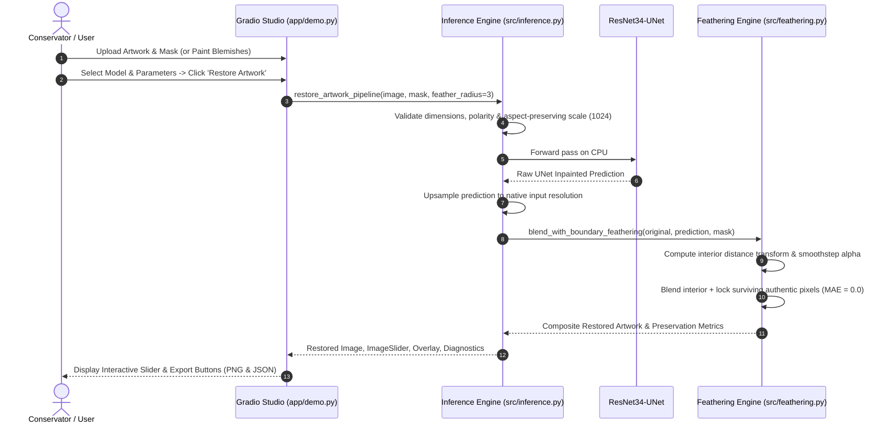

# MUESUM — Technical Architecture & System Design
**Project**: MUESUM (AI-Powered Historical Artwork Restoration)  
**Version**: 2.0  
**Author**: Lead Systems Architect / Computer Vision Engineer  

---

## 1. System Overview

MUESUM is a modular, high-fidelity neural image restoration platform engineered specifically for archival cultural heritage artifacts. The architecture bridges the gap between modern deep convolutional neural networks and the rigorous mathematical standards demanded by museum conservators.

```
┌────────────────────────────────────────────────────────────────────────┐
│                        MUESUM SYSTEM ARCHITECTURE                       │
└────────────────────────────────────────────────────────────────────────┘

    [The Met Museum Open Access API]
                  │
                  ▼
    [Data Acquisition & Curation] ───► [Synthetic Damage Engine]
                  │                             │
                  ▼                             ▼
    [Authentic Reference Clean]       [Damaged Substrate + Binary Mask]
                  │                             │
                  └──────────────┬──────────────┘
                                 │
                                 ▼
                    [ResNet34-UNet Inpainting]
                                 │
                                 ▼
                  [Raw Inpainted Reconstruction]
                                 │
                                 ▼
             [Interior Distance-Transform Feathering]
                                 │
                                 ▼
         [Curatorial Blending: 100% Bit-Exact Preservation]
                                 │
                  ┌──────────────┴──────────────┐
                  ▼                             ▼
       [Gradio Restoration Studio]   [CLI / Python API Engine]
```

---

## 2. Core Architectural Components

### 2.1 Neural Backbone: ResNet34-UNet (`src/unet_model.py`)
- **Encoder**: Pre-trained ResNet-34 feature extractor adapted for feature extraction across 5 spatial scales ($H/2, H/4, H/8, H/16, H/32$).
- **Skip Connections**: Residual skip connections pass high-resolution spatial features directly from early encoder residual blocks to matching decoder stages, preserving fine geometric lines.
- **Decoder**: Symmetrical upsampling blocks combining nearest-neighbor interpolation, convolution, Batch Normalization, and LeakyReLU activations.
- **Model Parameters**: **28,235,459 total trainable parameters**.
- **Input / Output**: Accepts 3-channel RGB $[B, 3, H, W]$ in $[0, 1]$; outputs restored 3-channel RGB $[B, 3, H, W]$ in $[0, 1]$.

### 2.2 Reusable Inference Engine & ModelManager (`src/inference.py`)
To prevent memory exhaustion and eliminate latency on repeated inference calls, MUESUM utilizes the `ModelManager` singleton pattern:
- **Thread-Safe Cache**: Keeps the active neural model in memory across user requests; avoids reloading 339 MB weight checkpoints on every click.
- **Memory Management**: Uses PyTorch `torch.inference_mode()` to eliminate computational graph tracking overhead, triggering immediate tensor deallocation after each inference pass.
- **Resolution Decoupling**: Accepts arbitrary input image resolutions. Large artworks are resized along their maximum dimension to an aspect-preserving ceiling ($1024\text{ px}$ standard, $1536\text{ px}$ high-resolution), while the final compositing step restores the image to native full resolution.

### 2.3 Interior Seam Feathering Engine (`src/feathering.py`)
Standard Gaussian blurring causes filter kernels to spill outside damage masks, corrupting authentic surviving pigment strokes. MUESUM solves this with an interior-only distance transform:
1. **Distance Field**:
   $$D(x, y) = \min_{(u, v) \in \partial \mathcal{M}} \sqrt{(x - u)^2 + (y - v)^2}, \quad \forall (x, y) \in \mathcal{M}$$
2. **Normalized Transition**:
   $$t(x, y) = \text{clip}\left(\frac{D(x, y)}{r}, 0.0, 1.0\right)$$
   where $r$ is the configurable feather radius (default $r = 3\text{ px}$).
3. **Smoothstep Hermite Interpolation**:
   $$\alpha(x, y) = \begin{cases} 
   0.0 & \text{if } (x, y) \notin \mathcal{M} \quad (\text{authentic surviving artwork}) \\
   3t^2 - 2t^3 & \text{if } (x, y) \in \mathcal{M} \quad (\text{interior transition zone}) \\
   1.0 & \text{if } D(x, y) \ge r \quad (\text{deep interior damage})
   \end{cases}$$
4. **Compositing Guarantee**:
   $$I_{\text{restored}}(x, y) = (1 - \alpha(x, y)) \cdot I_{\text{original}}(x, y) + \alpha(x, y) \cdot I_{\text{neural}}(x, y)$$
   $$I_{\text{restored}}(x, y) \equiv I_{\text{original}}(x, y) \quad \forall (x, y) \notin \mathcal{M}$$

### 2.4 Multi-Term Composite Restoration Loss (`src/composite_loss.py`)
The experimental model was fine-tuned with a multi-term objective:
$$\mathcal{L} = \mathcal{L}_{\text{L1-mask}} + 0.15 \mathcal{L}_{\text{Sobel}} + 0.01 \mathcal{L}_{\text{TV}} + 0.05 \mathcal{L}_{\text{VGG}}$$

- **Mask-Weighted L1**: $w_{\text{dmg}} = 4.0, w_{\text{undmg}} = 1.0$. Directs gradients specifically to missing substrate.
- **Sobel Edge Loss**: Computes horizontal and vertical luminance gradients ($\|\nabla Y_{\text{pred}}\| - \|\nabla Y_{\text{tgt}}\|$), enforcing sharp structural line work.
- **Total Variation Loss**: Suppresses checkerboard artifacts and spatial high-frequency noise.
- **Deep Perceptual Loss**: Uses VGG-19 features across layers `relu1_2`, `relu2_2`, and `relu3_4` to guide texture synthesis.

### 2.5 User Interface: Gradio Restoration Studio (`app/demo.py`)
Built on Gradio 6.0+:
- **Input Modes**: File Upload (Image + Mask) and Interactive Canvas (paint directly over blemishes using `gr.ImageEditor`).
- **Dynamic Dual Model Swapping**: Instant toggling between the Baseline Model and the Experimental Texture Model.
- **Interactive Sliding Comparison**: High-performance pixel curtain comparison with `gr.ImageSlider`.
- **Archival Export**: Generates full-resolution PNGs alongside machine-readable JSON provenance manifests.

---

## 3. Dataflow & Execution Pipeline



---

## 4. Hardware Optimization & CPU Execution

- **Batch Size 1 Sequential Processing**: Eliminates CPU RAM spikes, ensuring peak memory footprint remains $< 3\text{ GB}$ on 16 GB consumer laptops.
- **Aspect-Preserving Normalization**: Restricts neural tensor operations to maximum dimension 1024 while performing final compositing at native resolution.
- **Explicit Garbage Collection**: Intermediate PyTorch tensors and PIL Image handles are deallocated immediately upon completion of each forward pass.
