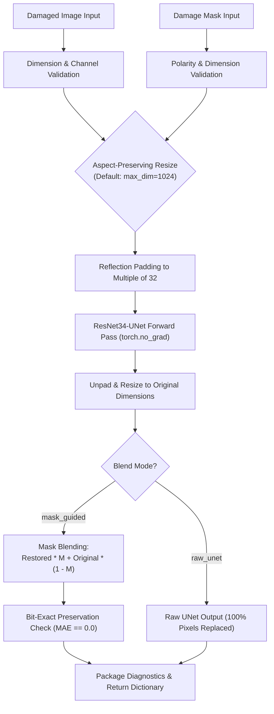

# MUESUM — Phase F.2: Inference Architecture & Application Design

**Document ID**: `reports/phase_f2_inference_architecture.md`  
**Date**: November 3, 2026  
**Status**: **PROPOSAL / DESIGN SPECIFICATION (Pending Approval)**  
**Target Milestone**: Phase F.3 (Implementation & Integration)  
**Hardware Context**: Intel Core i5-1235U (10 cores), 16 GB RAM, CPU-only environment  

---

## 1. Architecture Audit & Existing Pipeline Analysis

### 1.1 Existing Implementations Inspected
1. `src/inference.py`: Minimal CLI script executing `unet_restore(inp_path, out_path, ckpt_path)`.
   - **Limitations**:
     - Does not accept a damage mask.
     - Unconditionally overwrites $100\%$ of image pixels with raw UNet predictions, causing severe global color drift ($-3.03\text{ dB}$ on test set).
     - Reloads model weights from disk on every invocation.
     - Performs no dimension, channel, or mask polarity validations.
2. `src/unet_model.py`: Fully functional `ResNet34UNet` architecture with bilinear feature alignment in decoder skip connections. Expects input tensor in $[0, 1]$ and produces output in $[0, 1]$.
3. `src/dataset.py`: Contains `pad_to_multiple_of_32(img)` and `unpad(img, pad_info)` using reflection padding.
4. `src/utils.py`: Contains `tensor_to_uint8()`, `psnr()`, `safe_ssim()`, and `ensure_dir()`.
5. `app/demo.py`: Gradio web demo wrapping `unet_restore()`.
   - **Limitations**: Searches for non-existent checkpoint paths (`outputs/experiments/...` instead of `checkpoints/baseline_run/best_model.pth`). Does not accept a damage mask, offers no side-by-side or raw-vs-blended comparisons, and writes intermediate files to disk on every call.
6. `scripts/experiment_mask_blending.py` & `scripts/evaluate_mask_blending_200.py`: Successfully validated mask-guided blending on 10 and 200 samples, establishing the reference formula:
   $$\text{Final} = \text{round}\Big(\text{Restored}_{\text{raw}} \odot M + \text{Original} \odot (1 - M)\Big)$$

---

## 2. Mask-Guided Inference Interface Design (`src/inference.py`)

### 2.1 Core Function Contract: `restore_artwork_pipeline`

We propose refactoring `src/inference.py` to introduce an enterprise-grade, memory-efficient restoration engine while preserving backward compatibility for `unet_restore()`.

```python
def restore_artwork_pipeline(
    damaged_image: Union[str, Path, Image.Image, np.ndarray],
    damage_mask: Optional[Union[str, Path, Image.Image, np.ndarray]] = None,
    ckpt_path: Optional[Union[str, Path]] = None,
    model: Optional[torch.nn.Module] = None,
    device: Optional[torch.device] = None,
    blend_mode: str = "mask_guided",  # Options: "mask_guided", "raw_unet"
    max_dimension: Optional[int] = 1024,  # None for native resolution
    return_diagnostics: bool = True
) -> Dict[str, Any]:
```

### 2.2 Input Validation Specifications

1. **Image Validation**:
   - Accepts file path, PIL Image, or uint8 NumPy array.
   - Normalized to 3-channel RGB (`uint8`, shape $[H, W, 3]$).
   - If RGBA is passed, alpha is converted or stripped with a warning.
   - If Grayscale is passed, replicated to 3 channels.
2. **Mask Validation**:
   - If `blend_mode == "mask_guided"` and `damage_mask is None`:
     - **STRICT REQUIREMENT**: Raise an explicit `ValueError`:
       > *"Mask-guided blending requires a damage mask. If you wish to run unguided raw inpainting, set `blend_mode='raw_unet'`."*
     - The function will **never silently fabricate, guess, or synthesize a mask**.
   - **Dimension Matching**:
     - $\text{Mask shape}[0, 1] \equiv \text{Image shape}[0, 1]$. If mismatched, raise `ValueError(f"Mask dimensions {mask.shape[:2]} do not match image dimensions {img.shape[:2]}")`.
   - **Polarity & Normalization**:
     - Accept binary $\{0, 1\}$, uint8 $[0, 255]$, or float $[0.0, 1.0]$.
     - Enforce polarity: $1.0$ (or $> 127$) = damaged pixel; $0.0$ (or $\le 127$) = pristine artwork.
     - Validate that mask contains valid binary regions (warn if mask is completely 0 or completely 1).

### 2.3 Execution Flow & Mathematical Blending



### 2.4 Return Contract (Dictionary Structure)

The function returns a comprehensive dictionary:
```python
{
    "restored_image": np.ndarray,      # Final uint8 HxWx3 (blended or raw depending on mode)
    "raw_unet_image": np.ndarray,      # Raw UNet uint8 HxWx3 (for comparison)
    "original_image": np.ndarray,      # Standardized original uint8 HxWx3
    "mask_binary": np.ndarray,         # Binary uint8 HxW (0 or 255)
    "mask_preview": Image.Image,       # Semi-transparent red overlay on original for UI
    "diagnostics": {
        "blend_mode": str,             # "mask_guided" or "raw_unet"
        "original_size": (int, int),   # (width, height)
        "eval_size": (int, int),       # (width, height) processed by UNet
        "mask_coverage_pct": float,    # Percentage of image damaged
        "latency_ms": float,           # Total inference execution time in ms
        "undamaged_max_diff": int,     # Maximum pixel deviation in undamaged region (0 for blended)
        "undamaged_mae": float,        # Mean absolute error in undamaged region (0.000000 for blended)
        "preservation_status": str     # "100% Bit-Exact" or "Modified (Raw UNet)"
    }
}
```

### 2.5 Model Caching & Memory Management
- Introduce `ModelManager` class or cached module loader in `src/inference.py`:
  - Maintains a singleton model instance in memory so Gradio or batch CLI calls do not reload the 112 MB checkpoint on every sample.
  - Explicit garbage collection (`gc.collect()`) after inference to release intermediate feature tensors.
  - Thread-safe `torch.no_grad()` inference context.

---

## 3. Gradio Web Application Redesign (`app/demo.py`)

### 3.1 User Workflow & Interface Layout

The updated UI in `app/demo.py` will feature a dual-tab layout accommodating both users with precomputed masks and conservators who wish to interactively brush damaged regions:

```
┌────────────────────────────────────────────────────────────────────────────────────────┐
│ 🏛️ MUESUM — AI Historical Artwork Restoration Studio                                  │
│ Checkpoint: baseline_run/best_model.pth (Epoch 8) | Mode: Mask-Guided Inpainting      │
├────────────────────────────────────────────────────────────────────────────────────────┤
│ [ Tab 1: Upload Image + Mask ]    [ Tab 2: Interactive Brush Tool (No Mask File) ]     │
├────────────────────────────────────────┬───────────────────────────────────────────────┤
│ INPUTS:                                │ RESTORATION PREVIEW & COMPARISON:             │
│                                        │                                               │
│ 📷 Damaged Artwork (Upload)            │ ┌───────────────────────────────────────────┐ │
│ [ Upload Area / Drag & Drop ]          │ │   [Before / After Interactive Slider]     │ │
│                                        │ │   Damaged Original  ◄───►  Mask-Blended   │ │
│ 🎭 Damage Mask (Upload PNG / JPG)      │ └───────────────────────────────────────────┘ │
│ [ Upload Area / Drag & Drop ]          │                                               │
│                                        │ COMPARISON TABS:                              │
│ ⚙️ Inference Settings:                 │ ┌───────────────────────────────────────────┐ │
│ - Blend Mode: [x] Mask-Guided  [ ] Raw │ │ [Restored] [Raw UNet] [Damage Overlay]    │ │
│ - Target Resolution: [ 1024px  ▼ ]     │ └───────────────────────────────────────────┘ │
│                                        │                                               │
│ [ 🔧 Restore Artwork Button ]          │ 📊 Restoration Diagnostics:                   │
│                                        │ • Damage Coverage: 18.7%                      │
│                                        │ • Latency: 2.14 s (CPU)                       │
│                                        │ • Undamaged Preservation: 100% Bit-Exact (0)  │
│                                        │                                               │
│                                        │ [ ⬇️ Download Restored Artwork (High-Res PNG) ]│
└────────────────────────────────────────┴───────────────────────────────────────────────┘
```

### 3.2 Interactive Mask Brush Tool (Tab 2)
For users without a precomputed mask file:
- Utilize `gr.ImageEditor(type="pil", brush=gr.Brush(colors=["#ff0000"], default_size=20))` or Gradio sketchpad.
- Conservators can paint directly over cracks, mold spots, or scratches on the artwork.
- The UI automatically extracts the brush layer as a binary mask ($M$) and feeds it into `restore_artwork_pipeline()`.

### 3.3 Comparative Visualizations
1. **Interactive Image Slider (`gr.ImageSlider`)**: Enables smooth sliding between the original damaged input and the mask-blended restoration.
2. **Raw UNet vs. Mask-Blended Comparison**: Direct visual proof showing that raw UNet alters the entire painting, whereas mask blending preserves 100% of the surrounding canvas.
3. **Damage Overlay Preview**: Renders the mask as a semi-transparent red contour overlaid on the original image, confirming exact alignment before running.

---

## 4. Implementation Plan & Technical Specifications

### 4.1 Target Files

| File Path | Action | Description |
| :--- | :---: | :--- |
| `src/inference.py` | **Modify** | Implement `restore_artwork_pipeline()`, `ModelManager`, validation guards, and retain backward-compatible `unet_restore()`. |
| `app/demo.py` | **Modify** | Update to modern Gradio Blocks UI: mask upload, interactive brush, image slider, raw vs. blended comparison, and diagnostic metrics. |
| `tests/test_inference_pipeline.py` | **Create** | Comprehensive unit test suite verifying dimension checks, mask polarity validation, bit-exact preservation, and error handling. |

### 4.2 Unit Test Suite Specification (`tests/test_inference_pipeline.py`)

A standalone test suite will verify the implementation before deployment:

1. `test_exact_undamaged_preservation`:
   - Generate synthetic $256 \times 256$ RGB image and a central circular damage mask.
   - Run `restore_artwork_pipeline`.
   - Assert $\text{MAE}(\text{original}[\sim M], \text{restored}[\sim M]) == 0.0$ and $\text{MaxDiff} == 0$.
2. `test_dimension_mismatch_rejection`:
   - Pass a $256 \times 256$ image and a $300 \times 300$ mask.
   - Assert that `ValueError` is raised with a descriptive message.
3. `test_missing_mask_rejection`:
   - Pass `blend_mode="mask_guided"` with `damage_mask=None`.
   - Assert that `ValueError` is raised (no silent guessing).
4. `test_raw_unet_fallback`:
   - Run with `blend_mode="raw_unet"` and `damage_mask=None`.
   - Assert successful execution and verify `preservation_status == "Modified (Raw UNet)"`.
5. `test_mask_polarities`:
   - Test uint8 $[0, 255]$ mask and float $[0.0, 1.0]$ mask; assert identical mathematical outputs.
6. `test_memory_cleanup`:
   - Verify that tensors are detached and deleted, preventing RAM accumulation over multiple runs.

---

## 5. Workload Estimation & Phase F.3 Readiness

- **Estimated Implementation Time**: ~2 hours.
- **Risk Assessment**: **Very Low**.
  - All mathematical logic was already evaluated on the full 200-image dataset in Phase F.1.
  - Zero model retraining or weight modification required.
  - Changes are strictly confined to inference wrapper functions and UI presentation.
- **Readiness**: All architectural blueprints, validation contracts, and UI mockups are finalized. Awaiting user approval to proceed with Phase F.3 implementation.

